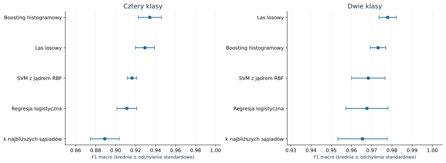

# Klasyfikacja jakości powietrza

Odtwarzalne badanie klasyfikacji czterech poziomów jakości powietrza oraz wpływu
połączenia ich w dwie klasy. Projekt obejmuje kontrolę jakości danych, zagnieżdżoną
walidację, strojenie pięciu rodzin modeli, analizę błędów i niepewności oraz
porównanie bezpośredniego modelu binarnego z agregacją prawdopodobieństw czterech klas.

**[Notebook z wykonanymi komórkami](notebooks/air_quality_study.ipynb)** ·
**[Raport HTML](reports/report.html)** · **[Metodologia](docs/methodology.md)** ·
**[Wyniki maszynowe](reports/holdout_metrics.json)** · **[Wnioski](reports/study_summary.md)**

Raport HTML należy pobrać i otworzyć w przeglądarce. Zawiera wszystkie wykresy,
działa bez sieci i nie wymaga uruchomienia serwera.

## Wyniki

<!-- RESULTS:START -->
| Zadanie | Model | Macro-F1 | Accuracy |
|---|---|---:|---:|
| Cztery klasy | Histogram Gradient Boosting | 0.9426 | 96.1% |
| Bezpośredni model binarny | Random Forest | 0.9749 | 97.9% |
| Agregacja czterech klas do dwóch | Histogram Gradient Boosting | 0.9797 | 98.3% |

Dla czterech klas 95% przedział bootstrap macro-F1 wynosi [0.9233; 0.9597]. Wyniki pochodzą ze wspólnego testu 1000 rekordów. Macro-F1 zadań o różnej liczbie klas nie porównujemy bezpośrednio.
<!-- RESULTS:END -->

Recall najrzadszej klasy `Hazardous` wynosi **86%** (100 obserwacji testowych).
To ograniczenie jest widoczne w raporcie klas i analizie pomyłek.



## Co jest oceniane?

Główny cel zachowuje `Good`, `Moderate`, `Poor`, `Hazardous`. Wariant dodatkowy ma
`1 = Poor/Hazardous` oraz `0 = Good/Moderate`. Nie utożsamia tych klas z indywidualną
rekomendacją zdrowotną ani z określonym oficjalnym indeksem AQI.

- Wspólny podział 4000 development / 1000 test, stratyfikacja według czterech klas.
- Pięć zewnętrznych i trzy wewnętrzne foldy; osiem konfiguracji na rodzinę i fold.
- Regresja logistyczna, kNN, SVM RBF, Random Forest i Histogram Gradient Boosting
  oraz punkt odniesienia przewidujący najczęstszą klasę.
- Imputacja, skalowanie i ewentualny SMOTE dopasowywane wewnątrz foldów.
- Wybór według macro-F1; test po zamrożeniu rodzin, hiperparametrów i progów.
- Raport klas, macierze pomyłek, kalibracja, 95% przedziały bootstrap, sparowane
  porównanie wariantów binarnych i analiza znaczenia cech.

## Uruchomienie

Zalecany Python **3.12**. Polecenia wykonuj z katalogu repozytorium.

```bash
python -m venv .venv
source .venv/bin/activate
python -m pip install -r requirements.txt
python -m pip install --no-deps -e .
python -m air_quality run --config configs/study.json
```

Na Windows PowerShell zamiast `source` użyj:

```powershell
.venv\Scripts\Activate.ps1
```

Pełna komenda generuje tabele, predykcje, modele lokalne, wykresy SVG, samowystarczalny
raport HTML i wykonany notebook. Nie wymaga konta Kaggle ani pobierania danych.
Domyślnie używa jednego procesu, co ogranicza wymagania i działa także w środowiskach
z ograniczoną obsługą procesów potomnych. W konfiguracji można wybrać do czterech workerów.

Szybkie odtworzenie prezentacji z istniejących wyników, bez treningu:

```bash
python -m air_quality report --output reports --execute-notebook
```

Predykcja po lokalnym treningu:

```bash
python -m air_quality predict --input data/example_features.csv
```

Wejściowy CSV zawiera dokładnie dziewięć nazwanych cech bez kolumny celu. Walidacja
odrzuca nieznane kolumny, tekst w liczbach, nieskończoności i całkowicie puste rekordy.
Wynik zawiera klasę, cztery prawdopodobieństwa i `P(Poor) + P(Hazardous)`.
Modele w `reports/models/` są lokalnymi artefaktami treningu i nie są przechowywane w Git.

## Weryfikacja

```bash
ruff check src tests scripts
ruff format --check src tests scripts
python -m pytest -q
python -m air_quality run --config configs/smoke.json
python scripts/verify_outputs.py
```

Testy sprawdzają m.in. orientację etykiet, reguły jakości, brak dopasowywania imputacji
i skalowania do predykcji, użycie SMOTE wyłącznie na treningowych foldach, niezmienność
centroidów podczas predykcji i sparowany bootstrap. Test techniczny wykonuje kompletny
pipeline na 500 rekordach i zapisuje wynik oddzielnie w `.ci_artifacts/`.
Nie zastępuje pełnego eksperymentu. GitHub Actions uruchamia te kontrole dla zmian kodu.

Skrypt `verify_outputs.py` niezależnie przelicza główne metryki z zapisanych predykcji,
sprawdza rozłączność podziału, hash danych i modułów obliczeniowych oraz wykonanie
notebooka. Nie dopasowuje żadnego modelu i nie wybiera ponownie parametrów na teście.

## Dane i ograniczenia

Źródło: **Mujtaba Mateen**, [Air Quality and Pollution Assessment](https://www.kaggle.com/datasets/mujtabamatin/air-quality-and-pollution-assessment),
wersja 2, licencja **Apache 2.0**. Atrybucja, jednostki i zapis metadanych:
[data/README.md](data/README.md).

Plik ma 5000 rekordów. Nie zawiera braków, ale ma 225 rekordów z naruszeniem ustalonych
reguł domenowych oraz 254 z co najmniej jedną flagą, wliczając PM2.5 > PM10.
Główny wariant maskuje błędne wartości i imputuje je w foldzie, zachowując wszystkie rekordy.
Eksperyment wrażliwości porównuje go z danymi surowymi.

Autor źródła nie dokumentuje stacji, dat, procesu pozyskania danych ani reguły tworzenia
etykiet. Pochodzenie z WHO/World Bank i syntetyczny lub pomiarowy charakter danych nie
są potwierdzone. Losowy test na tym zbiorze nie jest dowodem skuteczności w innych
miastach i okresach. Ten sam publiczny zbiór był już wcześniej analizowany, dlatego
nowy podział nie zastępuje walidacji zewnętrznej.

## Zawartość repozytorium

| Ścieżka | Zawartość |
|---|---|
| `src/air_quality/` | Walidacja, pipeline’y, modele, eksperymenty, raport i CLI |
| `configs/` | Pełny protokół i mały test techniczny |
| `data/raw/` | Niezmieniony plik źródłowy z kontrolą SHA-256 |
| `notebooks/air_quality_study.ipynb` | Analiza z wykonanymi komórkami i wykresami |
| `reports/report.html` | Samowystarczalny raport wyników |
| `reports/tables/` | Foldy, OOF, testowe predykcje, eksperymenty i wyniki strojenia |
| `reports/figures/` | Osobne wykresy wektorowe SVG |
| `docs/methodology.md` | Pytania badawcze, decyzje, założenia i literatura |
| `docs/legacy/` | Oryginalne opracowanie i opis zastąpionych elementów |
| `tests/`, `scripts/verify_outputs.py` | Testy i niezależne uzgodnienie wyników |

Kod i dane są udostępniane zgodnie z [Apache 2.0](LICENSE), z zachowaniem
atrybucji oryginalnego zbioru w [NOTICE](NOTICE).
